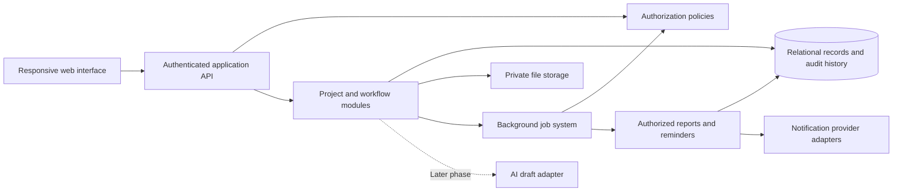

# WorkInProgress — Architecture

Last updated: 2026-10-11
Status: Node.js/SQLite pilot implemented and CI-tested; shared hosting/production rollout pending.
Source: [Complete project report](WorkInProgress_Complete_Project_Document.doc), especially §§5–12 and Added Input.

## Vendor member item name — 2026-10-11

Vendor itemName is stored on the project membership rather than global user profile. Legacy missing/null values remain valid. It is saved on creation/edit and included in edit audit before/after values. Existing project/member data remains; no destructive migration.

## Project PO number and authorized test reset — 2026-10-11

Project records now store nullable poNumber. No destructive schema migration is needed. Customer and internal views include the PO reference; vendor/service projections omit this customer PO field. Local reset was scoped to the single authorized project and related records, preserving the owner/configuration; ignored backup taken before reset.

## Member departments and editing — 2026-10-11

Membership records now hold departments[] and version, defaulting legacy missing values to [] and 1 without destructive migration. User profile version supports concurrent edits across projects. POST /api/projects/:project/members/:membership updates member details transactionally; profile fields are global, role/departments project-specific. Email corrections revoke old OTP/session records. Existing task assignee IDs remain unchanged.

## Local Windows verification — 2026-10-11

Local Windows runtime verified on Node.js v24.20.0: 24 automated tests and syntax checks passed; SQLite-backed server starts at http://127.0.0.1:3000. Health and login endpoints return HTTP 200. Development configuration .env and runtime database/mailbox are ignored by Git; no credentials or data are published. Real email and shared deployment remain pending.

## Verified shared application milestone — 2026-10-10

Implementation commit b92b2d31972d9737cd90f6576323687fc7b09e01 passed npm run check and all 24 automated tests on GitHub Actions (Node 24.21.0, Ubuntu). Evidence: https://github.com/kapil1304-design/WORKINPROGRESS/actions/runs/38072536855. Test coverage includes actual HTTP OTP/session/CSRF/logout, attempts/expiry, SQLite restart persistence, negative project/vendor/customer/file access, version/idempotency behavior, approval rules, scope allocation transaction rollback, quantity constraints, closure/reopening and reminder timing/deduplication/carryover.

DEV02/DEV03 core server workflows are implemented and automated checks passed; actual provider email, local Windows startup and visual browser QA remain unverified. No hosting, real participant invitation or production rollout occurred. Node installation is still waiting for the Windows administrator prompt. Tests ran remotely so this local installation delay did not prevent verification.

Current handoff: source is in server/ and web/, setup in DEVELOPMENT.md. Next continue remaining report workflows and browser/production readiness. User delegated routine decisions; do not restart discovery questioning.

## Shared application implementation — 2026-10-10

Current milestone supersedes the earlier browser-prototype-only implementation status. User requested continued project development. Assistant selected Node.js 24, built-in HTTP/crypto/SQLite and a responsive web client for the single-server pilot; no third-party runtime dependencies or hosting purchase.

Implemented source: server/store.js, server/auth.js, server/service.js, server/files.js, server/main.js and web/. Includes persistent transactional records, email OTP/session handling, project-scoped role checks, membership removal, allocation/acknowledgement/status, physical verification, supply quantities, approval workflows, scoped comments, private photo/PDF downloads, customer-safe projections/optional revision responses, owner-only reopening, and server reminder jobs in Asia/Kolkata. See DEVELOPMENT.md for setup and precise limits. Implementation is awaiting runtime test results at this handoff point.

Pilot assumptions: role purchase head=manager; 5-MB configurable upload cap (expected files remain under 1 MB); JPEG/PNG/WebP/PDF; expiry requires owner review, no deletion; active retention extends until closure. Member reporting is per project; late updates satisfy earlier outstanding periods. Evening reminder debt carries to next working morning; arbitrary outages before the previous working day are not reconstructed. Internal membership grants operational collaboration; external accounts see assigned work/private conversation plus designated internal contacts. Customer free-text status is excluded; explicitly shared comments/files remain visible.

Authentication development mode stores test codes in an ignored local mailbox, binds loopback, and cannot run in production. Real email integration uses Resend with provider credentials/verified sender, not yet exercised. Every actual login requires a single-use code; there is no demo identity selector in the shared app.

Verification pending: Node installation requires Windows administrator approval; service and HTTP/OTP tests are written in test/. GitHub Actions workflow runs syntax and tests. Do not mark tests passed until run. No shared deployment, actual email delivery, browser visual QA or backup restoration has been performed. Remaining report features are listed in DEVELOPMENT.md; not all F01–F36/AT01–AT38 are implemented or passed.

## Active development baseline — 2026-10-10

Latest user instruction authorizes development of a testable pilot and delegates remaining routine decisions to the assistant. Stop the sequential questionnaire; ask only for essential missing information. This supersedes earlier documentation-only scope and pending-question handoffs. Existing confirmed business rules remain binding.

Implementation assumptions (assistant-selected, revisable):
- Local development first, no hosting purchase or production launch. Browser prototype uses synthetic data only.
- Purchase head and purchase manager represent one role.
- Production timezone target Asia/Kolkata; current prototype uses browser local time.
- Active-project retention extends until closure; expired closed projects require owner review/export before any deletion. No automatic deletion.
- Reminders begin after a missed timeliness period, repeat in two-hour buckets during Monday–Saturday 09:00–19:30, and a later member update resolves earlier missed periods that day. No reminder debt for closed intervals. Sunday has no scheduled obligations.
- Simple version-one forms and configurable business data; no budget, launch date or service guarantee inferred.
- Initial technology is dependency-free HTML/CSS/JavaScript for a local workflow prototype. Secure shared pilot requires a server database, server authorization, real email OTP and unattended jobs; backend/provider choice will follow available runtime and deployment evidence.

Current output: [local pilot](app/index.html), [source](app/app.js), [prototype notes](app/README.md). Implements demonstrable projects, members, tasks, status updates, verification, approval requests, scoped demo views/comments, in-app alerts and closure/reopening.

Validation performed: seven isolated JavaScript workflow checks passed (self-approval denied; alternate task-date approver allowed; purchase manager delivery initiation denied; owner delivery approval; reciprocal scope approval; vendor task isolation; closed-project request denial). These test demo logic, not security. Static file references checked. Visual browser QA was not performed. Node is absent from PATH and its standard install path; Python launcher is unavailable.

Limitations: browser-local data and selectable demo identities; no actual email OTP, secure server enforcement, file uploads, unattended reminders, supply receipts/quantities, dependencies, customer acceptance action or production backup/recovery. No report acceptance register test is marked passed. Next milestone is secure multi-user foundation and completing these pilot workflows. Full original report scope is not represented as implemented.

## Architectural direction

The report proposes a responsive web interface, authenticated API, relational database, private file storage, and background jobs. Start with a modular application. Keep notification providers and AI behind replaceable adapters. Concrete frameworks, database engine, job technology, vendors, and hosting remain open decisions.

Initial operating scope confirmed on 2026-10-09: implementation in the user's company across about 20 projects for real-use testing and refinement. Some or potentially all may be active simultaneously; plan for approximately 20 concurrent active projects. Project concurrency is separate from simultaneous user/request load; user counts, activity and file volumes still need discovery before sizing infrastructure. Vendor/service-provider/customer access remains project-scoped under the existing rules. Offering the system to other companies will be discussed later; commercial subscription administration is deferred.

Participant planning limits supplied by the user are maximum 10 internal staff, 15 vendor organizations and 5 customer organizations. Multiple people from different departments within each external organization may need separate logins, as confirmed by the user. Organization count and account count must remain separate. Preserve individual identities, organizational/departmental affiliations and scoped project roles; evaluate each user's own grants instead of automatically exposing everything shared with their organization. The exact people per organization, activity rates, concurrent sessions and file volumes remain open. These planning maxima do not authorize hard-coded account quotas.

The diagram represents logical responsibilities, not a commitment to separate deployed services.

## Cloud hosting recommendation — 2026-10-09

The user expressed a tentative preference for cloud hosting because daily and project-based use will accumulate data. Cloud hosting is recommended for shared access by internal teams, vendors, service providers, and customers. This is an advisory direction, not approval of a provider, paid service, capacity, or deployment. D13 and D17 remain open.

Separate persistent storage from runtime memory (RAM): years of project history do not all need to be loaded into memory. Capacity planning must assess stored records/files and concurrent query/application load independently.

| Component | Proposed use |
| --- | --- |
| Managed relational database | Projects, tasks, users/grants, updates, chat text, approvals, quantities, audit history, and file metadata/references |
| Private object/file storage | Photos, drawings, PDFs, inspection evidence, video, and other binary attachments; separate from relational record bodies |
| Cloud application and background workers | Authorized web access, business workflows, reminders, reporting, and job processing |

Attachment size, number of revisions, and retention may drive storage growth; measure these before sizing. An illustrative 1,000 photos at 3 MB each is about 3 GB of original file data, excluding thumbnails, versions, replicas, and backups. This is arithmetic, not a workload forecast or storage purchase recommendation. Use indexed, filtered, paginated project queries rather than loading the entire history into RAM. Start with a pilot-sized configuration and monitor actual growth/load before increasing capacity.

Budget for application hosting, database, file storage, backups, network transfer, notifications, monitoring, and support. Configure budget alerts and agreed file-size/video limits. Decide completed-project archival/retention explicitly without losing required history or accessible references. Agree export/migration provisions to preserve access to company records when changing providers.

Cloud hosting does not establish vendor/customer privacy automatically; retain the authorization model below. Configure and test recovery for both database records and files. Managed database backups do not alone prove attachment recovery. Normal updates require internet/server acknowledgement; local drafts may support short interruptions, with full offline synchronization still deferred. Hosting region/data location must account for customer requirements, user location, and connectivity.

Current technical references supporting the recommendation: [Microsoft managed web/database architecture](https://learn.microsoft.com/en-us/azure/architecture/web-apps/app-service/architectures/basic-web-app), [object storage for files/images/video](https://learn.microsoft.com/en-us/azure/storage/blobs/storage-blobs-introduction), and [managed relational database backups](https://docs.aws.amazon.com/AmazonRDS/latest/UserGuide/USER_WorkingWithAutomatedBackups.html). These describe service capabilities, not a provider selection; the Microsoft basic web architecture is an introductory example, not a production deployment specification.

Before provider selection, estimate concurrent projects/users, updates/messages per day, attachment counts/sizes/types, retention/versions, connectivity, region needs, recovery targets, and an acceptable recurring budget. Record the eventual choice and rationale under D13/D17 and T004.

## Module boundaries

| Module | Responsibility |
| --- | --- |
| Identity and access | Accounts, invitations, organization/project membership, revocation, policy evaluation |
| Organization configuration | Admin-defined departments, roles, role assignments, explicit capabilities |
| Planning | Projects, modules, work packages, versioned templates, milestones, calendars, dependencies |
| Execution | Assignments, acknowledgement, updates, blockers, recovery actions, verification |
| Supply | Operational PO lines, trigger-based lead times, manufacturing stages, shipments, receipts, inspections |
| Services | Scoped deliverables, required inputs, visits/actions, evidence, acceptance |
| Change and approval | Baselines, scope changes, revision acknowledgements, customer decisions |
| Documents | Private files, revisions, audiences, publication review, authorized downloads |
| Conversations | Scoped chat membership, messages, replies, mentions, attachments, confirmed record actions |
| Automation | Calendar-aware reminder rules, escalation, digests, cancellation, retries |
| Reporting | Internal and customer projections, source links, weighted progress, as-of snapshots |
| Audit and operations | Significant-change history, health monitoring, failures, backup/restore, deployment support |

## Authorization model

Evaluate actor identity, organization relationship, active project membership, explicit capabilities, record scope, audience, and access state. Deny when no applicable grant exists. Read/write/assign/approve/export/manage-user capabilities are separate from role titles.

Every record access path must use the same effective policy: normal reads, writes, list queries, nested records, search/autocomplete, exports, downloads, chat events, report jobs, and notifications. Record IDs and frontend hiding are not authorization.

Internal members receive authorized operational access; commercial data can remain restricted. Customer projections expose relevant status through department/neutral labels and reviewed content. Vendor access intersects project participation with assigned work and approved inputs. Conversation membership is an additional scope and never follows automatically from project membership.

Customer status and file publication have separate policies: live permitted structured status must remain usable while an attachment awaits sharing review. Restricted free text must not be copied into customer projections automatically.

## Proposed record model

These are conceptual entities, not a finalized database schema. Relationships and constraints must be designed and validated before migrations are written.

| Record | Essential relationships / fields |
| --- | --- |
| Organization | Type, active state, settings; supplier/customer participation |
| User | Individual identity, account state; no shared login assumption |
| Department | Stable identifier, owning organization, configurable name/active state; user assignments; no fixed list in code |
| Role / capability grant | Definition distinct from designation; organization/project scope |
| Project membership | User, project, roles/capabilities, access state |
| Project | Customer organization, owner, code, order reference, calendar, timezone |
| Module / work package | Project parent, department, scope, hierarchy |
| Template / version | Reusable structure and role placeholders; no customer-confidential copies |
| Milestone / baseline revision | Original and approved commitments, approval history |
| Task / assignment | Project, scope, owner, dates, state, acceptance/evidence policy, verifier |
| Dependency | Same authorized project context, predecessor/successor, relationship, documented override |
| Progress update | Work record, author, event/entry times, completed/pending, forecast, source, version |
| Supply line | Specification, unit, required quantity, assigned vendor, lead-time basis, promises |
| Manufacturing stage | Supply/work package, stage, quantity, applicable drawing revision |
| Shipment | Supply line, quantity, dispatch evidence, tracking, expected arrival |
| Receipt / inspection | Shipment/line, received, accepted/rejected/held quantity, actual dates |
| Service deliverable | Scope, inputs, assignee, dates, evidence and verification policy |
| Blocker / recovery action | Affected work, resolver/action owner, deadline, impact, resolution |
| Approval cycle | Exact submission revision, designated approver, decision, time, return history |
| Change request | Scope delta, impacted work/quantities, proposed cost/time impact, decision |
| Document / revision / acknowledgement | Private file reference, revision, audience, affected assignments |
| Conversation / membership | Project, internal/customer/vendor/task scope, explicit participants |
| Message / edit / action link | Conversation, author, permitted attachments, linked source/record, edit history |
| Notification / rule | Trigger, recipient, audience, calendar, channel, delivery state, deduplication key |
| Report snapshot | Audience, as-of time, permitted sources, calculation version, preserved output |
| Audit event | Actor, object, action, before/after values, timestamp, change reason |

The confirmed 10 initial company departments are Mechanical, Design, Assembly, Procurement, Electrical Wiring, PLC Programming, Software Development, Installation, Stores and Material Control, and Testing. More departments can be added. Store them as configurable organization records with stable identifiers; additions/renames must preserve existing assignment references, scope and audit history. Other proposed functions remain unselected; do not seed them as approved defaults.

## Important data flows

### Update and completion

Authenticate and authorize the actor, validate the update against the current record version, save the confirmed update and audit event consistently, then queue appropriate projections/reminders. Independent verification policy prevents self-acceptance. Store submission and acceptance separately; preserve a return or reopening history.

### Dispatch to readiness

A vendor records shipment facts. Stores records physical receipt. Quality records accepted usable quantity. Readiness uses accepted quantity once, with explicit units, rather than dispatch count or vendor-reported completion. Rejection/short supply remains an exception with an owner.

### Dates and dependencies

Keep original baseline, current approved plan, assignee forecast, and actual dates distinct. Pilot dependencies use finish-to-start with cycle prevention. Calendar-aware impact indicates affected successors; automatic calculations never revise contractual dates. Advanced buffer/critical-path calculations are post-pilot proposals and must expose assumptions.

### Chat to record

Check conversation membership and access to linked objects. An authorized participant selects the proposed action, confirms owner/date/reason/visibility as applicable, and saves a structured action with its message reference and audit event. A message about a delay does not update the official forecast merely because it was posted. Repeated submission must not create duplicate actions.

### Customer projection and export

Select authorized project records, produce customer-safe structured fields, and include only approved narrative and files. Apply identity/commercial restrictions to filenames, title blocks, source links, participant labels, and metadata. Preserve report as-of time and past snapshots; recheck access at generation and delivery.

## Consistency and proposed reliability mechanisms

- Use database constraints and transactional writes where a workflow must remain consistent, such as quantities, verification, and its audit event.
- Use record versions for optimistic concurrency; return a conflict instead of silently replacing another change.
- Require idempotency for submissions, receipts, approvals, confirmed chat actions, and reminder events.
- A proposed implementation option is to record a pending job event with the domain transaction, then let a worker deliver it. Choose the concrete mechanism at architecture selection.
- Workers recheck completion/cancellation, current dates, membership, and audience before processing. Revocation invalidates future access-dependent jobs.
- Persist queued/sent/failed/retried states, bounded retries, and visible persistent failure. Delivery is not evidence of reading or acceptance.
- Enforce project timezone, working calendars, holidays, agreed cutoff, and explicit working/calendar-day lead-time basis.
- A local draft is not a submitted record. Server acknowledgement is required; deeper offline synchronization is deferred.

## Files and operational security

Use private storage with authenticated authorization-aware downloads or narrowly scoped expiring access. Recheck authorization for direct links; avoid persistent public file URLs. Validate types and sizes and scan where supported. Record file revisions/audiences and review customer publication.

Use separate credentials/data for development, staging, and production. Invitations expire; sessions and privileged access need appropriate protections. Log permission changes/admin access without putting credentials or sensitive contents into logs. The application cannot recall previously downloaded copies after revocation.

Before launch, agree retention, backup frequency, recovery objectives, hosting/data location, operational workload, and support ownership. Test restoration of both relational data and files. Monitor API/database availability, job failures, notification delivery, and storage; maintain rollback procedures.

## Later integrations

Email/messaging ingestion, AI/voice drafts, ERP connections, native apps, and optimization are later scope. AI receives only authorized material, creates attributed drafts, and cannot approve work or dates. Keep deterministic reporting available when optional providers fail. Confirm products, versions, costs, and provider data handling before implementation.

## Architecture validation gates

Before external-user access: prove negative project/vendor/chat/file access cases and customer-safe projections. Before workflow release: test quantity/date/verification/concurrency/idempotency invariants. Before production: validate representative load, restores, support ownership, and rollback. See AT01–AT30 in PRD.MD and the ordered backlog in TASKS.MD.

## Confirmed project authority and update policy — 2026-10-10

Source and approval: confirmed user answer during discovery, 2026-10-10. These are requirements awaiting implementation.

- The business owner creates new projects and adds project members over time.
- The business owner, project manager, and purchase head must be able to assign tasks to other team members within the project. This does not establish completion-verification, plan-change, or customer-commitment approval authority.
- All team members must compulsorily update status three times a day and also update status when another member requests it at any time during the day.
- Exact update times/windows, working-day calendar, response time for requested updates, missed-update escalation, and whether this cadence also covers external vendor/service/customer participants remain to be clarified. Do not assume immediate responses or three updates per task rather than per member.
- Requests for status must respect existing project/assignment visibility; requesting an update does not grant access to restricted information.
- Either owner or project manager may physically verify and approve non-purchase completion; next ask who may approve planned task date changes. Continue one question at a time, recording each answer.
Proposed implementation implications: enforce project creation, membership management and task assignment capabilities on the server; retain membership/assignment audit history. Support configurable update windows, timestamped status updates and scoped status-request records linked to responses. Scheduling, escalation and response deadlines await discovery.

## Confirmed completion verification — 2026-10-10

Source: user answer to the completion-verification question, 2026-10-10; confirmed requirement awaiting implementation.

- For non-purchase work, either the business owner or the project manager may approve completion after physically checking the work. One authorized approval is sufficient; both approvals are not required. Confirmed user clarification, 2026-10-10.
- For purchase work, the purchase manager must confirm completion. Do not assume the earlier purchase-head label and purchase-manager label refer to different people or the same role until clarified.
- A member's reported completion remains submitted for verification until the applicable authorized confirmation is recorded. Existing dispatch, receipt and accepted-quantity distinctions continue to apply; the purchase completion checkpoint remains to be specified.
- Next question: who may approve changes to planned task dates? Customer delivery commitment changes remain a separate decision.
## Confirmed task-date approver roles — 2026-10-10

Source: confirmed user clarification, "all 3", for planned task start/completion date changes. The business owner, project manager and purchase manager are all included as authorized approvers. Confirmed follow-up: one of these three initiates the date-change request, and a different one of the three approves it. The initiator cannot approve their own request; approval from the third person is not required. This answer does not establish authority to revise official customer delivery commitments or scope.

Preserve the original baseline, prior dates, change reason, requester, approving person(s) and approval time. Interface and server authorization must use the final agreed approval rule. These are documented requirements; no application implementation or test is complete.

The project manager initiates customer delivery-date changes and the business owner approves; customer notification is mandatory and acceptance optional; next ask project-scope change authority.
Confirmed task-date workflow clarification, 2026-10-10: preserve requester, requested dates, reason, decision, approving person and timestamps. Apply the approved task dates only after a different authorized person approves; retain original baseline and prior approved dates. This workflow is distinct from assignee forecast updates. Proposed UI exposes request and approve/return actions according to scope; server checks actor identity and authority. Application behavior and tests remain unimplemented.
## Customer delivery-date authority — 2026-10-10

Source: user's explicit correction of the previous answer, 2026-10-10. Confirmed requirement awaiting implementation.

- The project manager initiates a request to change the delivery date promised to the customer; the business owner approves it. These are distinct, fixed responsibilities.
- The earlier answer naming the purchase manager was withdrawn by the user. It grants no customer delivery-date authority.
- The project manager cannot approve their own request. The business owner's approval is required before changing the approved delivery commitment.
- Preserve the original customer commitment, requested revision, reason, requester, approving person, decision and timestamps. Keep forecasts separate from approved commitments.
- After business-owner approval, the customer must be notified of the revised delivery date and offered an option to accept it. Work must continue without waiting for customer acceptance. Record internal approval, notification and customer acceptance separately; silence does not mean acceptance.
- Scope-change authority is confirmed as reciprocal initiation/approval between business owner and project manager. Next clarify customer approval versus optional acceptance for scope changes.

## Revised delivery-date notification and acceptance — 2026-10-10

Confirmed user requirement: after project-manager initiation and business-owner approval, notify the customer of the revised delivery date and provide an acceptance option. Customer approval is not a gate to continued work. Display the owner-approved revised date and customer acceptance state separately; retain the original commitment and do not label an unaccepted revision as customer-agreed.

Proposed implementation implications: maintain a revision record with requested/approved dates, reason, internal decision, customer notification state and optional customer acceptance tied to that exact revision. Expose notification failure internally and retain customer responses. Do not pause execution because acceptance is pending. Notification channel and handling of an explicit customer objection remain open.

Next discovery question: must the customer approve a scope/specification change before affected work proceeds, or is notification with optional acceptance sufficient?
## Confirmed project-scope change authority — 2026-10-10

Source: confirmed user answer about adding/removing project work or changing machine specifications, 2026-10-10. Requirement awaiting implementation.

- If the project manager initiates a scope change, the business owner approves it.
- If the business owner initiates a scope change, notify the project manager; the project manager approves it.
- The initiator cannot approve their own change. These reciprocal responsibilities apply to scope changes; customer delivery-date changes retain the separately confirmed fixed project-manager initiation/business-owner approval rule.
- Apply the scope revision only after the other authorized person approves. Preserve original scope, requested revision, reason, affected tasks/specifications/quantities, proposed date/cost impacts, initiator, decision, approver and timestamps.
- Proposed UI and server behavior: scoped request/approve/return actions, notification to the project manager for owner-initiated changes, and rejection of self-approval or unauthorized approval. Preserve historical reports and disclose any progress-weight denominator changes.
- Confirmed follow-up: scope-change requests must be recorded and work continues without waiting for customer acceptance, rejection or approval. Customer response remains separate from internal scope approval. Within seven days, accept/reject the additional scope, assign accepted scope to the team, and notify the customer. The limit is seven calendar days from receipt of the change request.
- The period starts on receipt of the change request; next ask customer progress publication policy.
## Scope-change recording and customer response — 2026-10-10

Source: user follow-up about customer handling of scope/specification changes.

Confirmed: record the requested change; work must continue without waiting for customer acceptance, rejection or approval. Preserve the separately confirmed reciprocal internal owner/project-manager approval rule. Pending customer response must not be treated as acceptance.

Confirmed follow-up: within seven days, the company must accept or reject the requested additional scope, assign accepted additional scope to the team, and notify the customer of the decision and applicable allocation. Rejected scope is not assigned for execution. This is a scope-decision/allocation/notification deadline, not a deadline to complete the additional work or obtain customer approval. The user confirmed seven calendar days, including weekends and holidays, starting when the change request is received. Overdue handling remains to be clarified.

Customer progress visibility is confirmed: latest permitted progress whenever customers log in, without internal publication review. Evening window confirmed through 20:00, with reminders stopping at 19:30. Working days confirmed as Monday–Saturday; submission remains open on Sunday. Next ask reminder delivery channels.
## Confirmed additional-scope handling deadline — 2026-10-10

Source: confirmed user clarification. The company must complete its acceptance/rejection decision, assignment of accepted additional scope to the team, and notification to the customer within seven days. Retain the existing owner/project-manager reciprocal internal approval rule and authorized task-assignment roles. Customer response does not block continued work; rejected additional scope must not be assigned for execution.

Proposed implementation/design: record received/requested time, internal decision and reason, authorized decision-makers, team allocations, customer notification/delivery state and corresponding timestamps. Show pending decisions, unassigned accepted scope and notification failures. Calculate the deadline only after the period start and calendar/working-day basis are agreed. Additional work completion dates remain separately planned.

Customer progress visibility is confirmed: latest permitted progress whenever customers log in, without internal publication review. Evening window confirmed through 20:00, with reminders stopping at 19:30. Working days confirmed as Monday–Saturday; submission remains open on Sunday. Next ask reminder delivery channels. Overdue scope-request escalation remains open.
Calendar clarification, 2026-10-10: the confirmed additional-scope decision, accepted-work assignment and customer-notification deadline is seven calendar days, including weekends and holidays. Do not calculate it using working days. Confirmed follow-up: the seven-calendar-day period starts when the change request is received. Record receipt time as the deadline basis. Next ask whether permitted customer progress appears live or requires internal review. Existing internal approval responsibilities and continued work without waiting for customer response remain in force.
## Finalized additional-scope handling period — 2026-10-10

Confirmed user clarification: within seven calendar days from receipt of a change request, complete the internal acceptance/rejection decision, assign accepted additional scope to the team, and notify the customer. Weekends and holidays count. Preserve the reciprocal owner/project-manager approval rule. Customer response does not block continued work, and silence is not acceptance.

Record request receipt, resulting deadline, decision, accepted-scope allocation and customer notification timestamps. Exact timezone/cutoff and overdue escalation details remain open; implementation and application checks have not been performed.

Discovery handoff: scope handling duration and starting event are answered. Q05 is answered: customer-permitted progress is visible whenever customers log in. Evening window confirmed through 20:00 and reminders stop at 19:30. Scheduled days confirmed as Monday–Saturday; submission always open. Next ask Q06 reminder delivery channels. Continue one question at a time.
## Confirmed customer progress visibility — 2026-10-10

Source: user answer to Q05, "they can see it any time they login". Customers may view the latest permitted recorded progress whenever they log in; permitted structured progress does not wait for business-owner or project-manager publication review.

Continue to enforce customer/project/field access controls, department labels, restricted identities/commercial information and explicit file-sharing permissions. Show update timestamps, missing/stale updates and reported versus physically verified completion; visible progress is not automatically verified completion. This answer concerns progress visibility and does not approve automatic sharing of internal narratives, chat or attachments.

Proposed implementation/UI: authorized customer dashboard reads current permitted progress and freshness on login/access. Preserve the separate completion-verification and scoped-file publication rules. This remains a requirement awaiting implementation.

Scheduled times/windows are confirmed as 10:00 ±1 hour, 14:00 ±1 hour and 19:00 ±1 hour. Evening window confirmed through 20:00, with reminders stopping at 19:30. Working days confirmed as Monday–Saturday; submission remains open on Sunday. Next ask reminder delivery channels.
## Confirmed scheduled updates and reminders — 2026-10-10

Source: confirmed user answer to Q06.

| Scheduled time | Allowed update window |
| --- | --- |
| 10:00 morning | 09:00–11:00 |
| 14:00 afternoon | 13:00–15:00 |
| 19:00 evening | 18:00–20:00 |

Each scheduled update has a one-hour allowance before and after its scheduled time. Members may also voluntarily update at any time; the earlier obligation to respond to permitted requests from other members remains. Additional voluntary updates do not eliminate the scheduled-update requirement unless a counting policy is later agreed.

Superseding user clarification: update submission never closes. For missing scheduled updates, keep sending reminders or warnings every two hours during working hours of 09:00–19:30, and highlight missing updates to the business owner and project manager. The earlier two-reminder cap is withdrawn. Missing updates and reminders must never block work. First-reminder trigger, timezone, working-day calendar, notification channels and late-update reminder cancellation remain to be clarified.

Proposed implementation/UI: configurable scheduled windows; timestamped update history; visible missing-update flags; reminder records with bounded, deduplicated delivery. Keep work actions available when updates are missing. Customer freshness and reported/verified labels remain visible. No application implementation or reminder test has been performed.

Scheduled updates apply Monday–Saturday; submission stays open every day including Sunday. Next ask reminder and warning delivery channels.
## Superseding missing-update reminder policy — 2026-10-10

Source: confirmed user correction. Scheduled windows indicate when updates are expected; they never close the ability to submit. Continue reminders/warnings every two hours during working hours 09:00–19:30 for missing updates, and highlight the non-updating members to the business owner and project manager. This replaces the earlier two-reminder limit. Never stop or restrict work for missing updates.

Proposed implementation/UI: persistent missing-update flags, owner/project-manager exception views, auditable recurring reminder delivery with deduplication and authorization checks. No application behavior or tests are implemented. First-reminder trigger, late-update resolution/cancellation, timezone, working days and delivery channels remain open.

Confirmed timing clarification: the evening scheduled-update window remains 18:00–20:00, while reminders/warnings stop at 19:30. Submission remains available anytime, including after 20:00; the scheduled window is a timeliness measure, not a submission lock. Do not send reminders outside 09:00–19:30. Scheduled days are Monday–Saturday, with submission open every day. Next ask reminder delivery channels.
Evening timing confirmation, 2026-10-10: user confirmed keeping the 18:00–20:00 scheduled update window while reminders stop at 19:30. Keep submission available anytime and never block work. Reminder hours remain 09:00–19:30. Working days, timezone, first reminder trigger and notification channels remain open. Next discovery question: which channels should deliver reminders and warnings—in-app, email, WhatsApp, or a combination?
## Confirmed weekly update calendar — 2026-10-10

Source: user clarification. Status-update submission is always open, at any time on every day including Sunday. The three normal scheduled updates apply Monday through Saturday. Their ±1-hour periods measure timely reporting only; they never restrict submission.

Normal scheduled-update reminders follow Monday–Saturday, with delivery only during 09:00–19:30. Sunday has no normal scheduled-update obligation or associated reminder schedule. Preserve the ability to update voluntarily and the previously confirmed obligation to respond to permitted status requests; Sunday handling of such requests and outstanding reminders has not been separately specified.

The evening scheduled timeliness period remains 18:00–20:00 while reminder delivery stops at 19:30. No missing update or reminder blocks work. Holiday exceptions, timezone, first reminder trigger, carryover/resolution and delivery channels remain open.

Next question: which channels should carry reminders and warnings—in-app notifications, email, WhatsApp, or a combination?
## Confirmed platform phases and pending notification channels — 2026-10-10

Source: user clarification. First version is a web application only. A mobile application belongs to the second phase, after experience across approximately 20–50 projects. This is a phase gate for later discussion, not an approved mobile delivery date; whether project count means completed or handled projects remains open.

Notification channels are not decided. User supports the proposal of WhatsApp reminders containing a web link to submit the update, after WhatsApp integration. This does not authorize provider selection, integration spend or message sending.

Interim recommendation, not yet approved: in-app reminders/missing-update warnings and business-owner/project-manager exception views for the web version; email reminders with an authorized update-page link if users need notifications while the web app is closed. In-app notifications alone reach users when they open/use the application. Browser push can be evaluated separately if needed. WhatsApp integration is not required for the core update workflow.

Update links must require login and current project/task authorization; a link must not bypass access controls. No credentials or private status data in URLs. Keep reminder generation separate from delivery channels so email/WhatsApp can be added later without changing the reporting rules.

Phase-one in-app notifications are confirmed for everyone; email is not selected. Vendor/service-provider cadence is confirmed as the same schedule. Customer reporting exemption is confirmed; Q07 endpoint confirmed through final acceptance; either business owner or project manager may close the project. Acceptance documents are optional; closure is allowed anytime; closed projects stop updates and reminders until reopened; only the business owner may reopen; reopening resumes the last closing stage; English-only screens and multilingual comments confirmed; email OTP every login confirmed; connectivity is generally reliable with very rare interruptions; phase-one records are entered directly; photo/PDF-only attachments are confirmed; fewer than 50 attachments per project lifetime confirmed; files expected under 1 MB each; one-year maximum retention confirmed, extendable later; the period starts when the project starts; active-project retention extends automatically; next clarify extension duration.
## Confirmed phase-one notification channel — 2026-10-10

Source: confirmed user answer, "in app is fine for everyone in the first phase". Phase one uses in-app notifications for all participant types, with project/assignment/audience authorization enforced. Email reminders were proposed but not selected; WhatsApp integration remains a later proposal. No external messaging channel is required for phase one.

Provide members their permitted reminders/warnings and notify the business owner/project manager of missing updates through authorized in-app views. Persist notifications for viewing when users open the web app; do not imply out-of-app delivery. Existing reminder cadence, working hours, scheduled days and non-blocking work rules remain. Notification-channel approval does not extend internal scheduled-update obligations to external participants without clarification.

Vendor and service-provider members follow the same scheduled updates. Customers are exempt from compulsory updates and may write voluntarily. Q07 endpoint confirmed through final acceptance; either business owner or project manager may close the project. Acceptance documents are optional; closure is allowed anytime; closed projects stop updates and reminders until reopened; only the business owner may reopen; reopening resumes the last closing stage; English-only screens and multilingual comments confirmed; email OTP every login confirmed; connectivity is generally reliable with very rare interruptions; phase-one records are entered directly; photo/PDF-only attachments are confirmed; fewer than 50 attachments per project lifetime confirmed; files expected under 1 MB each; one-year maximum retention confirmed, extendable later; the period starts when the project starts; active-project retention extends automatically; next clarify extension duration.
## Confirmed vendor and service-provider reporting cadence — 2026-10-10

Source: user answer, "same for all", to whether vendors and service providers follow the same three scheduled daily updates. Internal team members, vendor members and service-provider members follow the same schedule: Monday–Saturday at 10:00, 14:00 and 19:00, each with ±1-hour timeliness allowance. Submission remains available at all times, including Sundays.

Missing scheduled updates follow the confirmed recurring two-hour in-app reminders/warnings during 09:00–19:30 and highlights to the business owner/project manager. Work is never blocked. This confirmed cadence supersedes the earlier proposed separate standard-product vendor confirmation cadence. Maintain organization/project/assignment access restrictions and avoid cross-vendor information disclosure.

Confirmed follow-up: customers have no compulsory status updates and may write whenever they choose. Do not send customer missing-status-update reminders. Separate customer approval/input workflows remain distinct. Next ask the project lifecycle endpoint under Q07.
## Confirmed customer reporting exemption — 2026-10-10

Source: confirmed user answer. Customers are not required to submit status updates and may write whenever they choose. Exclude customer members from compulsory three-times-daily reporting, missing-status-update warnings and escalation for failure to submit scheduled status updates. Internal staff, vendors and service providers retain the confirmed reporting obligations.

Customer messages and comments remain limited to authorized project/conversation audiences, with ordinary authorship and timestamps. Customers can continue viewing permitted progress whenever they log in and optionally accepting revised delivery dates. This reporting exemption does not settle separately tracked customer approval/input deadlines or reminder policies; do not invent such obligations.

Proposed UI/server behavior: no scheduled status-update compliance indicator or missing-update reminder for customer roles; permit voluntary writing within authorized conversations. Notification-channel access remains in-app for all phase-one participants. No application implementation or test is complete.

Lifecycle endpoint confirmed through installation and final acceptance at the customer site. Closure authority confirmed as either business owner or project manager; acceptance documents are optional; closure is allowed anytime; closed projects stop updates and reminders until reopened; only the business owner may reopen; reopening resumes the last closing stage; English-only screens and multilingual comments confirmed; email OTP every login confirmed; connectivity is generally reliable with very rare interruptions; phase-one records are entered directly; photo/PDF-only attachments are confirmed; fewer than 50 attachments per project lifetime confirmed; files expected under 1 MB each; one-year maximum retention confirmed, extendable later; the period starts when the project starts; active-project retention extends automatically; next clarify extension duration.
## Confirmed lifecycle endpoint — 2026-10-10

Source: confirmed user answer to Q07, "till final acceptance". Phase-one project tracking continues through installation and final acceptance at the customer's site, beyond factory testing and dispatch. This does not authorize post-acceptance warranty/service-management expansion.

Keep factory testing, dispatch, receipt, installation and final acceptance distinct milestones. Dispatch or installation completion alone does not mean project closure. Record final-acceptance criteria, evidence, authorized decision-maker, decision date and remaining punch-list items; detailed acceptance/closure policies remain to be agreed. The customer's scheduled-status reporting exemption does not remove a separately defined final-acceptance action.

Proposed implementation/UI: preserve authorized project access, progress, blockers and milestone history through final acceptance. Include installation and final-acceptance milestones in phase-one planning and customer views. No application implementation or tests are complete.

Either business owner or project manager may close the project. Acceptance documents are optional; closure is allowed anytime; closed projects stop updates and reminders until reopened; only the business owner may reopen; reopening resumes the last closing stage; English-only screens and multilingual comments confirmed; email OTP every login confirmed; connectivity is generally reliable with very rare interruptions; phase-one records are entered directly; photo/PDF-only attachments are confirmed; fewer than 50 attachments per project lifetime confirmed; files expected under 1 MB each; one-year maximum retention confirmed, extendable later; the period starts when the project starts; active-project retention extends automatically; next clarify extension duration.
## Confirmed project closure authority — 2026-10-10

Source: confirmed user answer, "we will close it --me or project manager". Either the business owner or the project manager may close the project; one authorized closure action is sufficient. This does not require reciprocal approval under the separate scope-change rule.

Maintain tracking through final acceptance as already confirmed. Record closure actor, time and supporting evidence. Who supplies final-acceptance evidence, whether customer sign-off is required, and treatment of open punch-list items remain to be clarified. Do not equate an internal closure action with customer acceptance without evidence.

Proposed implementation/UI: scoped closure action for business owner/project manager, server authorization and audit history; final-acceptance/closure criteria to be finalized before implementation. No application implementation or test is complete.

Acceptance documents are optional, with an attachment option. Closure is allowed anytime; closed projects stop updates and reminders until reopened; only the business owner may reopen; reopening resumes the last closing stage; English-only screens and multilingual comments confirmed; email OTP every login confirmed; connectivity is generally reliable with very rare interruptions; phase-one records are entered directly; photo/PDF-only attachments are confirmed; fewer than 50 attachments per project lifetime confirmed; files expected under 1 MB each; one-year maximum retention confirmed, extendable later; the period starts when the project starts; active-project retention extends automatically; next clarify extension duration.
## Confirmed optional acceptance document — 2026-10-10

Source: user answer to whether a customer-signed acceptance document must be uploaded before closure: a document is not necessary, but the option must exist. Record the acceptance document as optional, with attachment and authorized viewing/download available when provided.

Either business owner or project manager may close the project without a mandatory acceptance-document upload. Record the authorized closure action and timestamp; do not label closure as customer-signed acceptance unless such evidence actually exists. Existing private-file access/sharing rules apply to optional documents.

Proposed closure interface: optional acceptance attachment; no required-document validation blocking closure. Application implementation and tests remain pending. Handling of open punch-list items remains undecided.

Closure is allowed anytime by owner/project manager. Closed projects stop updates and reminders until reopened; only the business owner may reopen; reopening resumes the last closing stage; English-only screens and multilingual comments confirmed; email OTP every login confirmed; connectivity is generally reliable with very rare interruptions; phase-one records are entered directly; photo/PDF-only attachments are confirmed; fewer than 50 attachments per project lifetime confirmed; files expected under 1 MB each; one-year maximum retention confirmed, extendable later; the period starts when the project starts; active-project retention extends automatically; next clarify extension duration.
## Confirmed unrestricted closure timing — 2026-10-10

Source: confirmed user answer, "we can close anytime". Either business owner or project manager may close a project at any time, including with pending tasks, punch-list items or acceptance milestones. Do not require all items completed or an acceptance document before closure.

Project closure is separate from task completion and final acceptance: retain actual outstanding-item and milestone states, prior evidence, actor and closure timestamp. Do not automatically mark pending work completed, invent customer acceptance, or set progress to 100% merely because the project is closed. The lifecycle supports tracking through final acceptance, but does not impose final acceptance as a closure gate.

Proposed implementation/UI: authorized close action with no all-items-complete validation; display the closed project and its outstanding records truthfully. Whether outstanding work stays active with reminders after closure, and reopening authority, remain to be clarified. No application implementation or tests are complete.

Closed projects stop execution updates and reminders until reopened. Only the business owner may reopen a project; reopening resumes the last closing stage; English-only screens and multilingual comments confirmed; email OTP every login confirmed; connectivity is generally reliable with very rare interruptions; phase-one records are entered directly; photo/PDF-only attachments are confirmed; fewer than 50 attachments per project lifetime confirmed; files expected under 1 MB each; one-year maximum retention confirmed, extendable later; the period starts when the project starts; active-project retention extends automatically; next clarify extension duration.
## Confirmed closed-project behavior — 2026-10-10

Source: confirmed user clarification, "close means close---until we re-open". Closure stops project execution updates and project-related reminders/warnings, including pending-task and missing-status reminders, until the project is reopened. Preserve outstanding states and history; do not mark unfinished work completed or erase records.

The general always-open status submission rule applies to open projects; a closed project is the explicit exception. Proposed implementation/UI: closed project records remain available for authorized historical viewing, execution/update actions are disabled, and queued reminders are cancelled or suppressed with a current-state check before delivery. Record closure/reopening events and actors. No application implementation or tests are complete.

Reopening authority, whether pending tasks resume unchanged, and reminder scheduling after reopening remain to be clarified. Do not create missed-update obligations for the period the project was closed.

Only the business owner may reopen a closed project. Reopening resumes the last closing stage; English-only screens and multilingual comments confirmed; email OTP every login confirmed; connectivity is generally reliable with very rare interruptions; phase-one records are entered directly; photo/PDF-only attachments are confirmed; fewer than 50 attachments per project lifetime confirmed; files expected under 1 MB each; one-year maximum retention confirmed, extendable later; the period starts when the project starts; active-project retention extends automatically; next clarify extension duration.
## Confirmed project reopening authority — 2026-10-10

Source: confirmed user answer, "only me". Only the business owner may reopen a closed project. The project manager may close a project under the existing rule but cannot reopen it.

Proposed implementation/UI: expose the reopen action only to the authorized business owner and enforce that permission on the server. Preserve the closed interval, reopening actor/time and existing task/milestone history. Do not generate missing-update obligations for the closed interval. No application implementation or permission tests have been performed.

Whether all outstanding tasks resume unchanged, and when scheduled reminders restart after reopening, remain to be clarified.

Reopening resumes the last closing stage and recorded work state. English-only screens and multilingual comments confirmed; email OTP every login confirmed; connectivity is generally reliable with very rare interruptions; phase-one records are entered directly; photo/PDF-only attachments are confirmed; fewer than 50 attachments per project lifetime confirmed; files expected under 1 MB each; one-year maximum retention confirmed, extendable later; the period starts when the project starts; active-project retention extends automatically; next clarify extension duration.
## Confirmed reopening resumption — 2026-10-10

Source: confirmed user answer, "reopen on last closing stage". When the business owner reopens a project, resume from the stage and recorded work state at its most recent closure, rather than restarting the project.

Preserve completed and pending task/milestone states, assignments, dates, evidence and history. Reopening does not automatically reset progress, reassign work or shift approved dates. Any later task-date or scope changes follow their separately confirmed approval rules. Only the business owner may reopen.

Proposed implementation/UI: retain the pre-closure execution stage independently of closed status and restore it on reopening. Record reopening actor/time and resume open-project update availability; do not create missing-update obligations for the closed interval. Exact reminder restart handling remains open. No application implementation or tests are complete.

English-only screens and comments in any language are confirmed. Email OTP every login confirmed; connectivity is generally reliable with very rare interruptions; phase-one records are entered directly; photo/PDF-only attachments are confirmed; fewer than 50 attachments per project lifetime confirmed; files expected under 1 MB each; one-year maximum retention confirmed, extendable later; the period starts when the project starts; active-project retention extends automatically; next clarify extension duration.
## Confirmed phase-one language policy — 2026-10-10

Source: confirmed user answer. All screens use English only. Comments may be written in any language.

Use English navigation, labels, instructions, validation messages and system notifications. Preserve multilingual comments as entered using Unicode-capable storage, rendering and exports; do not require English-only comments or silently translate them. Automatic translation and voice input are not approved by this answer. Existing comment/conversation access controls apply regardless of language.

Proposed implementation/UI: English interface with Unicode text entry/display and suitable font fallback for multilingual comments. No application implementation or language tests are complete.

Every login uses an email OTP. Internet generally reliable with very rare interruptions; phase-one records are entered directly; photo/PDF-only attachments are confirmed; fewer than 50 attachments per project lifetime confirmed; files expected under 1 MB each; one-year maximum retention confirmed, extendable later; the period starts when the project starts; active-project retention extends automatically; next clarify extension duration.
## Confirmed email-OTP login — 2026-10-10

Source: confirmed user answer. Every login requires a one-time code sent to the user's email. Email/password login is not the selected method. This does not require an OTP for every page or action within an authenticated session; session lifetime remains to be decided.

Authentication email delivery is required for phase one despite operational reminders/notifications being in-app only. Keep authentication delivery separate from status-reminder channels. Email delivery provider, code expiry, retry limits, resend behavior, session duration and recovery procedures remain implementation/operating decisions.

Proposed implementation/UI: enter registered email, request OTP, enter and verify a single-use code, then access authorized project records. Protect codes, prevent reuse, bound verification attempts and resend requests, and avoid exposing account existence. Never log raw codes or place them in update URLs. No authentication implementation or tests have been performed.

Internet reliability is confirmed as generally reliable with very rare interruptions. Next ask essential ERP/accounting/Excel integrations for phase one.
## Confirmed connectivity assumption — 2026-10-10

Source: confirmed user answer. Internet is generally reliable across the discussed work locations; interruptions are very rare. This is a user-reported planning assumption, not a measured uptime guarantee.

Plan phase one around an online web workflow. No full offline editing or synchronization requirement is established by this answer. Proposed handling of rare interruptions: clearly show failed or pending submission, preserve unsent form text where practical, allow retry, and avoid duplicate saves or falsely displaying an unsaved update as submitted. This is a design recommendation awaiting implementation.

Phase one uses direct entry; no ERP/accounting/Excel connection required. Photo/PDF-only attachments are confirmed; fewer than 50 attachments per project lifetime confirmed; files expected under 1 MB each; one-year maximum retention confirmed, extendable later; the period starts when the project starts; active-project retention extends automatically; next clarify extension duration.
## Confirmed phase-one direct entry — 2026-10-10

Source: confirmed user answer. Enter projects, tasks and operational purchase references directly into the web app. No existing ERP, accounting-system or Excel connection is required for phase one. This does not approve accounting, inventory valuation or ERP-replacement functionality; purchase records remain operational references under the existing scope.

Proposed implementation/UI: authorized direct-entry forms with validation and audit history; core execution must not depend on external-system synchronization. Optional imports/exports and later integrations remain separate scope decisions. No application implementation or tests are complete.

Q08 language, login, connectivity and essential-integration questions are answered. Photo/PDF-only attachments are confirmed. Fewer than 50 attachments per project lifetime confirmed; files expected under 1 MB each; one-year maximum retention confirmed, extendable later; the period starts when the project starts; active-project retention extends automatically; next clarify extension duration.
## Confirmed phase-one attachment types — 2026-10-10

Source: confirmed user answer, "photo and pdf only". Phase-one attachments are limited to photos and PDF documents. CAD files, videos and other file categories are outside this selected upload scope.

Proposed implementation/UI: photo/PDF upload and authorized viewing/download, with server-side type validation and existing private-file/project/assignment/audience permissions. An acceptance document remains optional and may be attached as a permitted PDF or photo. Specific photo formats, per-file size limits, upload volumes, retention and storage budget remain to be decided. No upload implementation or tests have been performed.

Expected attachment count is fewer than 50 photos/PDFs combined per project lifetime. Files expected under 1 MB each; one-year maximum retention confirmed, extendable later; the period starts when the project starts; active-project retention extends automatically; next clarify extension duration.
## Confirmed attachment-volume estimate — 2026-10-10

Source: user answer to expected attachment count across one project's lifetime. Expect fewer than 50 photos and PDFs combined per project. This is a planning estimate, not an enforced upload quota. File sizes and retention remain open; count alone does not establish storage capacity or cost.

Files are expected to be under 1 MB each. One-year maximum retention confirmed, extendable later; the period starts when the project starts; active-project retention extends automatically; next clarify extension duration.
## Confirmed attachment-size estimate — 2026-10-10

Source: user answer to the largest expected uploaded photo/PDF. Files are expected to be under 1 MB each, with fewer than 50 files combined per project lifetime. This implies approximately under 50 MB of original attachment payload per project, or under 1 GB across 20 projects, before copies, previews, backups and other records. These are planning estimates, not enforced upload or storage quotas.

A hard upload limit, precise MB unit and handling of larger files remain implementation decisions; do not reject larger uploads solely on the basis of an expected-size answer. Retention and backup/recovery policies remain open.

Initial maximum retention is one year, extendable later. The period starts when the project starts. Active-project retention extends automatically; next clarify extension duration.
## Confirmed initial retention duration — 2026-10-10

Source: user answer to closed-project record/attachment retention. Initial maximum retention is one year; the user may extend it later if required.

Confirmed user clarification: the one-year retention period starts when the project starts, not when it closes or when each file is uploaded. The distinction between project creation date and configured project start date remains to be specified if they differ. Expiry behavior (automatic deletion versus owner review/export), treatment of reopened projects, backups and audit records remain undecided. No deletion or retention job is authorized or implemented by this documentation change.

Proposed implementation/design: configurable retention duration so a later approved extension is possible; preserve the final agreed retention deadline and expiry policy in operating documentation.

Automatic extension for active projects is confirmed. Next clarify whether extension lasts until closure or adds another full year.
## Confirmed retention starting event — 2026-10-10

Source: confirmed user clarification. The initial one-year maximum retention period starts when the project starts. It is not a one-year period after closure and does not restart for each uploaded attachment.

Extension remains possible by later decision. Automatic deletion, active-project expiry handling, reopening effects and backup retention are not decided. Do not implement deletion based solely on this duration. The exact project-start field/date basis must be defined during design if creation and actual/planned start differ.

Automatic extension for active projects is confirmed. Next clarify whether extension lasts until closure or adds another full year.
## Confirmed automatic active-project retention extension — 2026-10-10

Source: confirmed user answer, "automatic extention", to retention when a project is still active after one year. Automatically extend retention for an active project rather than requiring business-owner approval. Do not expire or delete its records/attachments merely because the first year has elapsed while it remains active.

The baseline period is one year from project start. Extension duration/increments and retention after eventual closure remain to be clarified; do not infer a new full year or automatic deletion on closure. Reopening and backup retention details also remain open. No retention automation or deletion is implemented.

Next question: should automatic extension keep the records until the project closes, or add another full year each time?
## Maintenance

Update after selecting technologies, implementing/changing modules or schemas, changing policy boundaries, integrating a provider, or changing hosting/operations. Label deployed facts separately from proposals. Link durable decisions to MEMORY.MD and update affected RULES.MD, DESIGN.MD, and TASKS.MD.

## Change log

| Date | Change |
| --- | --- |
| 2026-10-08 | Documented the report's proposed architecture and conceptual data model, including department/role configuration and scoped chat. |
| 2026-10-09 | Added advisory cloud hosting direction, separate database/file/RAM sizing, cost/recovery/connectivity considerations, and provider-selection inputs. |
| 2026-10-09 | Recorded confirmed own-company, approximately 20-project phase and deferred commercial offering; cloud sizing remains open. |
| 2026-10-09 | Recorded potential concurrency of all 20 projects; user/request/file workload remains required for capacity selection. |
| 2026-10-09 | Recorded 10 internal staff, 15 vendors and 5 customers for pilot sizing; external account multiplicity remains to be clarified. |
| 2026-10-09 | Confirmed external organization counts with multiple departmental users needing individual accounts and scoped access. |
| 2026-10-09 | Recorded the seven confirmed initial departments and expandable stable-ID department configuration; suggested departments remain unapproved. |
| 2026-10-09 | Expanded confirmed initial department configuration to 10 with Installation, Stores and Material Control, and Testing. |

| 2026-10-10 | Recorded confirmed project creation/member management, task-assignment authority and mandatory three daily plus requested updates; advanced discovery to completion verification. |

| 2026-10-10 | Recorded physical completion confirmation by owner/project manager and purchase confirmation by purchase manager; left approval combination and purchase checkpoint open. |

| 2026-10-10 | Clarified that either owner or project manager may approve non-purchase completion after physical verification; advanced discovery to planned task date-change authority. |

| 2026-10-10 | Confirmed owner, project manager and purchase manager as task-date approver roles; independent versus joint approval remains open. |

| 2026-10-10 | Confirmed task-date changes require one initiator and a different approver among owner/project manager/purchase manager; prohibited self-approval and advanced discovery to customer delivery-date authority. |

| 2026-10-10 | Recorded business owner and purchase manager as customer delivery-date authority; exact approval workflow and customer agreement remain open. |

| 2026-10-10 | Corrected customer delivery-date authority: project manager initiates and business owner approves; superseded the withdrawn purchase-manager answer. Customer acceptance versus notification remains open. |

| 2026-10-10 | Confirmed mandatory customer notification and optional acceptance of revised delivery dates; work continues without customer approval and acceptance remains separately recorded. Next: scope-change authority. |

| 2026-10-10 | Confirmed reciprocal scope-change initiation/approval between owner and project manager, with project-manager notification for owner requests; customer scope approval remains open. |

| 2026-10-10 | Recorded scope-change requests and continued work without waiting for customer decision; seven-day requirement remains pending clarification. |

| 2026-10-10 | Clarified seven-day additional-scope limit covers acceptance/rejection, assignment of accepted scope and customer notification; period start and day basis remain open. |

| 2026-10-10 | Confirmed additional-scope handling limit is seven calendar days; request-receipt starting point remains pending confirmation. |

| 2026-10-10 | Confirmed seven-calendar-day scope handling period starts at receipt of the change request; advanced discovery to Q05 customer progress publication. |

| 2026-10-10 | Confirmed Q05 customer visibility of latest permitted progress on login without internal publication review; advanced discovery to three daily update times. |

| 2026-10-10 | Recorded 10:00/14:00/19:00 updates with ±1-hour windows, voluntary updates anytime and two missed-update reminders without work blocking; reminder timing remains open. |

| 2026-10-10 | Superseded two-reminder cap with recurring two-hour reminders/warnings during 09:00–19:30 and owner/project-manager highlights; submissions remain open and work continues. Evening window overlap requires clarification. |

| 2026-10-10 | Confirmed evening update window remains 18:00–20:00 while reminders stop at 19:30; advanced discovery to applicable working days. |

| 2026-10-10 | Confirmed Monday–Saturday scheduled reporting and always-open submission including Sundays; advanced discovery to reminder delivery channels. |

| 2026-10-10 | Confirmed web-only first version and later mobile phase after about 20–50 projects; recorded WhatsApp-link proposal and unapproved interim in-app/email recommendation. |

| 2026-10-10 | Confirmed in-app notifications for all phase-one participants; email not selected and WhatsApp deferred. Next clarify vendor/service-provider reporting cadence. |

| 2026-10-10 | Confirmed common scheduled reporting for internal, vendor and service-provider members; superseded separate vendor cadence proposal and left customer reporting for clarification. |

| 2026-10-10 | Confirmed no compulsory customer status updates and voluntary writing anytime; advanced discovery to Q07 project lifecycle endpoint. |

| 2026-10-10 | Confirmed phase-one lifecycle through installation and final acceptance at customer site; next clarify final-acceptance authority and criteria. |

| 2026-10-10 | Confirmed either business owner or project manager may close a project; customer final-acceptance evidence and punch-list policy remain open. |

| 2026-10-10 | Confirmed optional acceptance-document attachment without blocking project closure; next clarify open punch-list handling. |

| 2026-10-10 | Confirmed owner/project manager may close anytime with pending items, retaining truthful task/acceptance states; post-closure pending-task behavior remains open. |

| 2026-10-10 | Confirmed closed projects stop execution updates and reminders until reopened, preserving pending states/history; next clarify reopening authority. |

| 2026-10-10 | Confirmed only business owner may reopen closed projects; reopening resumes the last closing stage; English-only screens and multilingual comments confirmed; email OTP every login confirmed; connectivity is generally reliable with very rare interruptions; phase-one records are entered directly; photo/PDF-only attachments are confirmed; fewer than 50 attachments per project lifetime confirmed; files expected under 1 MB each; one-year maximum retention confirmed, extendable later; the period starts when the project starts; active-project retention extends automatically; next clarify extension duration. |

| 2026-10-10 | Confirmed owner-led reopening resumes last closing stage with recorded work state/history preserved; advanced discovery to Q08 interface language. |

| 2026-10-10 | Confirmed English-only screens and comments in any language; advanced discovery to Q08 login method. |

| 2026-10-10 | Confirmed email OTP for every login, separate from in-app operational notifications; advanced discovery to connectivity. |

| 2026-10-10 | Recorded user-reported reliable internet with very rare interruptions; advanced discovery to essential phase-one integrations. |

| 2026-10-10 | Confirmed direct entry and no required ERP/accounting/Excel integration for phase one; advanced discovery to Q09 attachments. |

| 2026-10-10 | Confirmed phase-one attachments limited to photos and PDFs; advanced discovery to approximate project-lifetime attachment count. |

| 2026-10-10 | Recorded fewer than 50 attachments per project lifetime as a planning estimate; files expected under 1 MB each; one-year maximum retention confirmed, extendable later; the period starts when the project starts; active-project retention extends automatically; next clarify extension duration. |

| 2026-10-10 | Recorded expected files under 1 MB each and approximate attachment payload; advanced discovery to closed-project retention. |

| 2026-10-10 | Confirmed initial one-year maximum retention with possible later extension; next clarify whether the period starts at project closure. |

| 2026-10-10 | Confirmed one-year retention starts when the project starts; active-project extension and expiry behavior remain open. |

| 2026-10-10 | Confirmed automatic retention extension for projects still active after one year; extension duration and post-closure expiry remain open. |

| 2026-10-10 | User authorized pilot development and delegated remaining assumptions; local workflow prototype implemented and seven isolated logic checks passed. |

| 2026-10-10 | Implemented Node/SQLite shared web application, OTP adapter, scoped workflows, files and reminder jobs; tests written and runtime verification pending. |

| 2026-10-10 | Recorded verified shared application milestone: GitHub Actions syntax check and all 24 tests passed; actual email/browser/local deployment checks remain pending. |

| 2026-10-11 | Verified installed Node.js, local tests/startup and local OTP flow; inspected responsive login layout. |

| 2026-10-11 | Added project-specific member departments and audited owner correction editing; all 29 local tests passed and live local app restarted with existing data preserved. |

| 2026-10-11 | Added project PO number and cleared the explicitly authorized single test project; 30 tests passed and app restarted. |

| 2026-10-11 | Added project-specific vendor member item name with editing; 32 local tests passed and live app restarted. |
